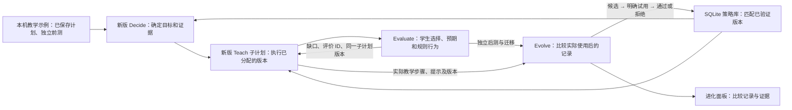

# 教学进化：运行、展示与验收

此版以团队完整工作台为底座，沿用上一版的四模块闭环。在右上角打开「教学进化试验」。固定案例复用真实 V0.2.1 Decide 和 Teach 子计划，并从实际保存的待办教材检查点读取项目背景。评估和验证采用固定 Benchmark。普通项目的自然教学、团队原 V0.2.1 联调端口、以及本项目的反思记录有各自的使用场景。参见 [本次融合审计](EXPERIMENT_BASE_MERGE.md)。



## 启动

```powershell
python -m pip install -r requirements.txt
python -X utf8 backend.py --port 8772
```

打开 http://127.0.0.1:8772，在「教学进化试验」选择已有学生或创建档案，再新建真人试验。固定待办案例不需要模型密钥；普通的项目教学对话可用原入口连接模型。三个阶段使用学生选择的规则运行固定输入，比较预期和实际；它不运行学生提交的任意代码，也不把项目源码标记、浏览器事件或点击次数当成测试结果。前测与后测评分使用四维独立分，按 85 分权重归一到 100。五维总分另含迁移，没有齐全证据时留空。每维显示等级和证据 ID。默认掌握线 80（启动前可设 CONTROL_MASTERY_THRESHOLD），还要求无提示、独立迁移和行为检查通过、验证维度至少 3。该量表只用于此案例，未做真实学生量表校准。

## 真人试教

1. 第一位学生新建「当前策略」试验：前测 → 观察和讲授 → 引导练习 → 后测 → 独立迁移。引导中若验证薄弱，观察新版子计划插入补练并关联对应评价。后测薄弱才会落下有适用条件的候选；学生已掌握时无需强行提候选。
2. 为另外三位学生分别新建本机档案；用「对照教学」补一个基线，用「试用匹配的候选」收集两位候选学生。必须同一难度、知识点、量表与掌握门槛，初始四维分差不超过 10。同一人重复测可以留档，但不重复参加比较。
3. 有两组可比配对后，系统按事前规则判断。四维增益差平均至少 5，独立后测、迁移等级改善，迁移通过、行为通过和提示负担不得变差，否则保留失败证据并拒绝。候选在默认教学中不启用；被验证版本只自动用于匹配范围。小样本用来验证机制和试点门槛，不能证明因果效应。
4. 面板可展开查看改动、依据、后续是否安排、分数和提示。用另一位符合条件的学生发起默认试验，可查看新版本是否被调用；前测仍发现相同缺口时才改变 Decide 学习目标。

本机档案直接复用工作台学生名单，可跨项目选择同一档案。策略试验保存该档案的评价引用。L1 项目记录和会话证据、L2 按档案读取个人评价、L3 按版本保留去标识结果。L3 无学生原始聊天或个人档案标识出口。SQLite 保留策略正文哈希、状态历史、各阶段证据和实际的教学动作。

## 复跑隔离的模拟演示

```powershell
python -X utf8 scripts/demo_teaching_evolution.py --out ..\demo-run
$env:CONTROL_WORKBENCH_DATA = (Resolve-Path ..\demo-run).Path
python -X utf8 backend.py --port 8772
```

目录必须是新目录，脚本拒绝覆盖现成 SQLite。打开「教学进化试验」→「记录」→「模拟实验」。模拟答卷由脚本明确输入，真实 HTTP、评分、重排、选择和状态迁移均运行；看见的是由真实执行计算得到的**模拟成绩**，不属于真人结果。结束后关闭后端并执行 `Remove-Item Env:CONTROL_WORKBENCH_DATA`，正常工作台继续使用自己的数据库。JSON 含测试台账，可独立复查。

## 新接口与兼容

| 接口 | 内容 |
|---|---|
| GET / POST /api/students | 复用工作台本机学生档案 |
| GET /api/teaching/strategy-trials[/simulation] | 真人或模拟版的策略版本、状态历史、可比较结果 |
| POST /api/tasks/:id/teaching/experiment | 显式指定 profile_id、arm=default/baseline/candidate；需通过 scenario=strategy-trial 新建待办教材项目 |
| GET /api/tasks/:id/teaching/experiment | 读当前阶段，独立考核阶段不返回教学步骤 |
| POST /api/tasks/:id/teaching/experiment/submit | stage、revision、answers、predictions。拒绝过期或重复提交 |

固定试验在同一数据库事务完成评价、状态更新与持久化。临时教学变化留在学生会话内；普通聊天中的教师建议继续保持暂定状态。已知边界：真实模型和真人收益尚未验证，受控案例只覆盖输入边界验证。批量回归、脚本及浏览器冒烟可在无模型的环境复现。

## 本次实际验证

- 工作台回归与 6 项闭环验收一起运行，输出见本次融合审计。闭环覆盖真实 HTTP 回合、缺失值与提示上限、独立迁移门槛、候选晋升/拒绝、重复档案筛除、重开 SQLite、跨项目个人回读。
- Chrome 本地隔离实例打开面板，用 SQLite 实际验证模拟对比、创建试验、提交前测与练习、出现由反馈触发的补练。没有调用真实联网模型。
- 模拟数据库有 3 次完成试验、1 条达到模拟门槛的经验：第一次 38.24 → 38.24、迁移 2/4；候选试用 38.24 → 100、迁移 4/4；第三次回读已验证版本与决策经验。输入是脚本明确提供的模拟答卷，以上只用于验收机制。
